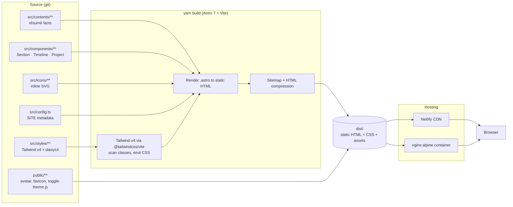
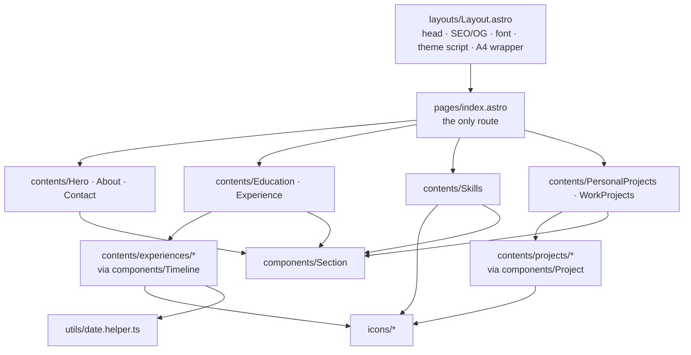

# Architecture

This document describes how the resume site is built and delivered. It is a **static, build-time-rendered, single-page site**. Several topics you might expect (real-time sync, authentication) intentionally do not apply, and the relevant sections say so rather than invent mechanisms.

## 1. System Architecture

### Build and delivery

### Page composition (build time)

### Layers

| Layer | Location | Responsibility | May depend on |
| --- | --- | --- | --- |
| Route | `pages/index.astro` | Page grid and section order | layouts, contents, components |
| Layout | `layouts/Layout.astro` | `<head>`, SEO/OG, font, theme bootstrap, A4 wrapper | `config.ts`, styles |
| Content | `contents/**` | All résumé facts | components, icons, utils |
| Components | `components/**` | Content-agnostic UI primitives | utils |
| Assets | `icons/**`, `public/**` | SVG icons, static files | none |
| Config | `config.ts`, `astro.config.mjs` | Site metadata, integrations | none |

Dependencies point downward only. A component never imports from `contents/`.

### Data flow

1. **Authoring.** Résumé facts are written as markup and props inside `.astro` files. There is no CMS, JSON or content collection.
2. **Build.** Astro renders each component to HTML during `yarn build`. Props such as `from` and `to` pass through `formatDate()` (`utils/date.helper.ts`), which returns `Mon, YYYY`, `Present` for empty input, or `Invalid Date` for unparseable input.
3. **Styling.** Tailwind v4 scans the sources and emits only the CSS that is used. daisyUI themes and design tokens come from `src/styles/tailwind.css`.
4. **Output.** `dist/` contains static HTML, CSS and `public/` assets, plus the sitemap.
5. **Delivery.** Netlify's CDN, or nginx in a container, serves the files. Nothing is computed per request.

## 2. State Management & Real-time Sync

**There is no application state, no real-time channel and no network data layer.** There are no REST calls, no WebSockets or SignalR, and no client-side store or framework.

| Concern | Mechanism |
| --- | --- |
| Content | Immutable at build time (props to templates to HTML) |
| Theme (the only runtime state) | `localStorage["theme"]` (`light` or `dark`) mirrored to `<html data-theme>` by `public/toggle-theme.js`. The checkbox `#theme-btn` in `ThemeToggle.astro` drives it. The initial value is the stored value, else `prefers-color-scheme`. The script also listens for OS theme changes. |
| Print | `PrintButton.astro` sets the theme to light, unchecks the toggle and calls `window.print()`. `@media print` rules in `tailwind.css` and `print:` utilities then take over. |

The theme script is loaded `is:inline` in `<head>` so `data-theme` is set before first paint, which avoids a flash of the wrong theme. Keep that script's position and the `#theme-btn` id stable.

If a feature ever needs external data, fetch it at build time in component frontmatter. Do not add runtime fetching or hydration without a design discussion.

## 3. Performance Strategy

The site's performance comes from shipping very little.

- **Static HTML, zero hydration.** No `client:*` directives and no UI-framework runtime. The only JavaScript is the small inline theme script and the print-button handler.
- **Code splitting and lazy loading are not needed.** There is a single route and no JS bundles to split. Do not add dynamic imports or lazy-loaded components for their own sake.
- **Minimal CSS.** Tailwind v4 emits only the utilities that appear in the source. daisyUI is registered with `themes: false` and two hand-defined themes (`light`, `dark`), so unused theme CSS is not shipped.
- **HTML compression.** `compressHTML: true` in `astro.config.mjs`.
- **Inline SVG icons** (`src/icons/*`) instead of an icon font or library. This means no extra requests, they take theme colors via `currentColor`, and they print crisply.
- **Fonts.** Nunito loads from Google Fonts with `preconnect` and `display=swap` to avoid blocking text rendering.
- **Static assets** live in `public/` and get long-lived caching from the CDN. Keep images reasonably sized and compressed, and always include `alt` text.
- **Container delivery.** The multi-stage Docker build ships only `dist/` on `nginx:alpine`, and nginx strips `.html` and trailing slashes with 301 redirects.

**Rules for contributors**

1. Don't add runtime dependencies or client JavaScript without approval.
2. Prefer utility classes over new global CSS.
3. Verify print layout (A4, page breaks) after any visual change.
4. Watch `yarn build` output for unexpected size or warning changes.

## 4. Security & Authentication

**There is no authentication, session or user data.** The site is public and read-only.

| Area | Position |
| --- | --- |
| Auth / sessions | None |
| Backend / API surface | None, so there is no server-side injection or authorization surface |
| Secrets | None; no environment variables are required. Never commit credentials. |
| Persistent client data | Only the theme preference in `localStorage` |
| Third-party requests | Google Fonts (CSS and font files). No analytics or trackers in the repo. |
| External links | Use `target="_blank"` together with `rel="noopener noreferrer"` on new or edited links |
| Personal data | The resume intentionally publishes a name, email and phone (`contents/Contact.astro`). Don't add further personal data (addresses, IDs, credentials) |
| Supply chain | Dependencies are pinned by `yarn.lock` and installed with `--frozen-lockfile` in Docker. Review dependency bumps and never hand-edit the lockfile. |
| Transport | HTTPS is provided by Netlify. For container deploys, terminate TLS in front of nginx. |

**Recommended hardening (not currently implemented)**

- Security headers (CSP, `X-Content-Type-Options`, `Referrer-Policy`) via `nginx.conf` or Netlify `_headers`
- Self-hosting the font to drop the Google Fonts dependency
- Automated dependency auditing in CI (`yarn audit`, Dependabot or Renovate)

## 5. Build & Deploy Pipeline

| Stage | Tool | Notes |
| --- | --- | --- |
| Commit gate | Husky `commit-msg` and commitlint | Enforces Conventional Commit types |
| Verify | `yarn lint` and `yarn build` | There is no unit test suite and no typecheck script (`@astrojs/check` is not installed) |
| Build | `astro build` to `dist/` | Node 24 |
| Deploy (primary) | Netlify, from git | Configured in the Netlify UI; no `netlify.toml` |
| Deploy (alternative) | `Dockerfile` to nginx | Copies `src/`, `public/`, `astro.config.mjs`, `tsconfig.json`. Update the Dockerfile if the build starts depending on other root files. |

No CI workflow exists in the repository.

## 6. Known Pitfalls

- **Case-sensitive filenames.** `src/contents/projects/` holds `Per-LaSoTuVi.astro`, `Per-Lasotuvi.astro` and `per-lasotuvi.astro`. Only the first is imported. Linux and Docker builds are case-sensitive, so import casing must match the file on disk exactly.
- **Quote style.** Prettier is configured for single quotes, but existing files mix single and double quotes. Don't reformat unrelated lines.
- **Dark mode** is keyed on `[data-theme="dark"]` through a custom Tailwind variant, not the `.dark` class.
